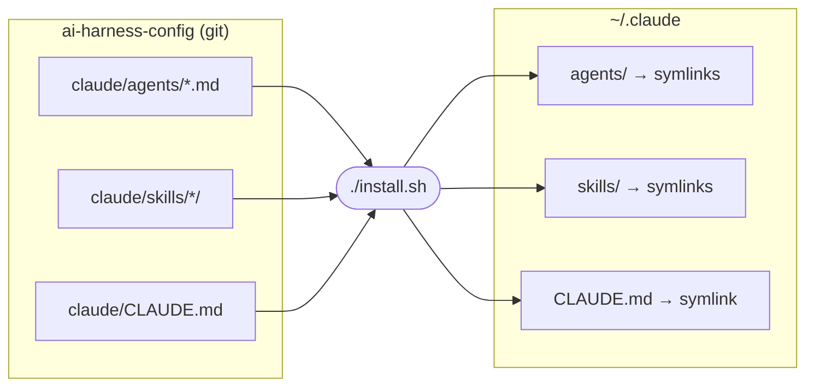

<div align="center">

# 🧠 ai-harness-config

**Личный харнесс для Claude Code: агенты, скиллы и правила, по которым идёт разработка**

<p>
  
  
  
  
</p>

<sub>Качество результата важнее экономии токенов · каждая роль — отдельный агент · всё под git</sub>

</div>

---

## ✨ Зачем

`~/.claude` — обычная папка без истории: правка агента или скилла не оставляет следа, откатить её нельзя. Здесь источник правды — этот репозиторий, а `~/.claude` собирается из него симлинками. Любое изменение поведения агента видно в `git diff` и `git log`.

Принципы, по которым репозиторий собран:

- **Качество, а не экономия токенов.** Модель выбирается по типу работы, а не по цене: рассуждения, планы и ревью идут на Opus, код и тесты на Sonnet. Вывод проверок не обрезается через `head`/`tail`: ошибка на 31-й строке остаётся ошибкой.
- **Одна роль — один агент.** Разработчик не ревьюит свой код, ревьюер ничего не правит, планировщик не пишет код.
- **Агент не привязан к проекту.** Метод работы живёт в агенте, конвенции — в `CLAUDE.md` проекта, задача и сводка стека — в брифе от оркестратора. Новый стек (мобилка, десктоп, Rust) добавляется новым агентом, остальные не меняются.
- **Правило без автоматики нарушается.** То, что можно проверить хуком, проверяется хуком: формат коммитов, например.

## 🗺️ Как устроено



Правишь файл в репозитории — Claude Code видит изменение сразу, перезапуск не нужен: он следит за `~/.claude/agents/` и `~/.claude/skills/`.

### Цикл задачи

```mermaid
flowchart LR
    SP["spec<br/><sub>диалог, дизайн по секциям</sub>"] --> PP["planner<br/><sub>Mode: partitions</sub>"]
    PP --> OK{{"спека утверждена"}}
    OK --> PB["planner<br/><sub>Mode: brief</sub>"]
    PB --> EX["исполнитель из ## SDD<br/><sub>в своём worktree</sub>"]
    EX --> G["гейт<br/><sub>гоняет ведущий</sub>"]
    G --> RV["ревьюер<br/><sub>одно ревью</sub>"]
    RV --> FX["фикс-раунд<br/><sub>тот же исполнитель</sub>"]
    FX --> MG["мерж --no-ff<br/><sub>в ветку фичи</sub>"]
    MG -->|следующая партия| PB
    MG -->|все партии| FR["итоговое ревью по слоям<br/><sub>+ security при флаге</sub>"]
    FR --> PR["pr.md → PR<br/><sub>по команде владельца</sub>"]
```



- **`spec`** пишет спеку вместе с тобой: вопросы по одному, дизайн по секциям, разбиение на партии от `planner`.
- **`sdd`** ведёт партии по таблице в спеке. Состояние живёт в файлах (`.claude/context/sdd/<фича>/`), поэтому после `/clear` работа продолжается с той же партии.
- **Ревью одно, фикс один, повторного ревью нет.** Исполнителя не отпускают, пока не закончен его фикс-раунд.
- **Мелкие задачи** на одну партию идут без SDD: `issue-start` → код → `issue-done`.

Настройки проекта живут в разделе `## SDD` его `CLAUDE.md`: таблица «слой → исполнитель → ревьюер», команда гейта, основная ветка, тип репозитория (пет / рабочий), режим PR. Шаблон — `claude/skills/sdd/references/claude-md-sdd.md`. При первом запуске в проекте `sdd` спрашивает, рабочий это репозиторий или пет, и заполняет раздел сам. В рабочих репозиториях артефакты SDD уходят в `.git/info/exclude`, а `.gitignore` проекта не меняется.

## 🤖 Агенты

| Агент | Модель | Режим | Что делает |
|---|:---:|:---:|---|
| **Планирование** ||||
| `planner` | Opus | 👁️ | Два режима: `partitions` режет дизайн на партии с владельцами из `## SDD`, `brief` пишет бриф партии, заново проверив каждую премиссу грепом |
| **Разработка** ||||
| `frontend-dev` | Sonnet | ✍️ | React / Next.js, Vue / Nuxt |
| `node-dev` | Sonnet | ✍️ | Node.js / TypeScript бэкенд: NestJS, Fastify, Prisma, Postgres, Redis, WebSocket |
| `devops-dev` | Sonnet | ✍️ | Один VPS: docker compose, nginx, certbot, ufw, GitHub Actions. Не деплоит и не генерирует секреты |
| **Качество** ||||
| `test-dev` | Sonnet | ✍️ | Unit- и интеграционные тесты. Каждый новый тест проверяет мутацией: портит строку, которую тест охраняет, и ждёт красного |
| `e2e-dev` | Sonnet | ✍️ | Playwright: сначала проходит сценарий в браузере через MCP, потом пишет спеку; стабильность — `--repeat-each=10` |
| `build-fixer` | Sonnet | ✍️ | Чинит tsc / lint / build / `cargo check` минимальным диффом. Каждый `as any` и `@ts-ignore` — в отчёт с причиной |
| `refactor-cleaner` | Sonnet | ✍️ | Удаляет мёртвый код и зависимости пачками по knip, с полным прогоном проверок после каждой пачки |
| **Ревью** ||||
| `frontend-reviewer` | Opus | 👁️ | Ревью фронта и тестов: «какую строку испортить, чтобы тест покраснел?» |
| `backend-reviewer` | Opus | 👁️ | Ревью бэка: доступ к чужим id, идемпотентность, границы транзакций, миграции, контракт |
| `security-reviewer` | Opus | 👁️ | Уязвимости с конкретным путём атаки; вердикт BLOCK / APPROVE WITH CHANGES / APPROVE |
| **Сервис** ||||
| `telegram-manager` | — | ⚙️ | Исполнитель вызовов Telegram MCP для скилла `Telegram` |

<sub>✍️ пишет код · 👁️ только читает: у `planner` и `security-reviewer` это закреплено списком `tools`, у `frontend-reviewer` и `backend-reviewer` пока только промптом ([#005](issues/005-agent-audit.md)) · ⚙️ служебный</sub>

Промпты новых агентов — на английском (дешевле в токенах на рассуждениях), отчёты агенты пишут на русском. Формат промпта: роль в 1–2 строки → Workflow → чеклисты → Hard rules → Output, 70–130 строк. Список тем, которые модель и так знает («React 19, `oklch()`, V8 hidden classes…»), в промпт не попадает: поведение меняют конкретные правила, а не каталог.

## 🧩 Скиллы

| Скилл | Когда срабатывает |
|---|---|
| **Процесс** ||
| `spec` | «распиши план по #N», «давай сделаем фичу»: спека с партиями |
| `sdd` | «запускай SDD», «следующая партия»: партии через агентов, ревью, мерж, `pr.md` |
| `issue-start` | «бери issue 7»: задача на одну партию — ветка, правила проекта |
| `issue-done` | «issue готов»: критерии приёмки, зелёные проверки, коммиты по скоупам, PR |
| `git-flow` | коммиты `type(scope): subject` с эмодзи; bootstrap ставит хук в любой репозиторий |
| `project-checkpoint` | «сделай чекпоинт»: `STATUS.md` и хэндофф перед `/clear` |
| **Дисциплина** (копии из superpowers 6.4.1, [VENDORED](claude/skills/VENDORED.md)) ||
| `systematic-debugging` | баг или красный тест: сначала причина, потом правка |
| `test-driven-development` | тест до кода, и он должен упасть |
| `verification-before-completion` | перед словом «готово» — команда и её вывод |
| **Проектирование** ||
| `project-architect` | «хочу сделать новое приложение X»: идея → проект-документ |
| `domain-modeling` | словарь предметной области и ADR |
| **Текст и дизайн** ||
| `humanize` | любой текст-объяснение про код: убирает воду, требует адрес, число или поведение |
| `ui-ux-pro-max` | дизайн UI по локальной базе стилей, палитр и шрифтов (сторонний скилл) |
| **Интеграции** ||
| `Telegram` | чтение и поиск по чатам через telegram-mcp ([#006](issues/006-telegram.md)) |

## 🔌 Плагины

Ставятся через `claude plugin install`, в репозитории не лежат:

| Плагин | Зачем |
|---|---|
| `superpowers` | **отключён**: процесс заменён скиллами `spec` и `sdd`, debugging / TDD / verification скопированы — [#001](issues/001-own-superpowers.md) |
| `playwright` | агент сам проходит сценарии в браузере |
| `frontend-design` | визуальный дизайн |
| `skill-creator` | создание и проверка скиллов |
| `context7` | актуальная документация библиотек; слетает авторизация — [#002](issues/002-context7-auth.md) |
| `typescript-lsp`, `rust-analyzer-lsp` | нестабильны — [#003](issues/003-lsp-flaky.md) |

## 🚀 Установка

```bash
git clone <repo> ~/Projects/ai-harness-config
cd ~/Projects/ai-harness-config
./install.sh --dry-run   # показать, что изменится
./install.sh
```

`install.sh` для каждого агента, скилла и `CLAUDE.md` создаёт симлинк в `~/.claude`. Если на месте симлинка лежит обычный файл или папка, они уезжают в `~/.claude/backups/harness-<дата>/`, не удаляются. Повторный запуск ничего не меняет. Симлинки на файлы, удалённые из репозитория, установщик убирает.

Не трогает: `settings.json`, память агентов (`~/.claude/agent-memory/`), скиллы claude.ai (`~/.claude/skills/synced/`).

## 📝 Коммиты

Формат — `type(scope): subject`, эмодзи по типу добавляет хук `.githooks/commit-msg`. Это POSIX `sh` без зависимостей, тот же файл скилл `git-flow` ставит в любой репозиторий: JS, Rust, конфиги.

```bash
git config core.hooksPath .githooks       # один раз после клона
git config commit.template .gitmessage
```

```text
feat(agents): add security-reviewer   →   ✨ feat(agents): add security-reviewer
```

| ✨ feat | 🐛 fix | ♻️ refactor | ⚡️ perf | ✅ test | 📝 docs | 🎨 style |
|:-:|:-:|:-:|:-:|:-:|:-:|:-:|
| **🔧 chore** | **🚀 ci** | **🚚 move** | **🗑️ remove** | **🚧 wip** | **🎉 init** | |

Скоупы этого репозитория (`.gitflow`): `agents` `skills` `rules` `install` `docs` `issues`. Хук отклоняет неизвестный тип, неизвестный или пустой скоуп и заголовок длиннее 72 символов.

## 📁 Структура

```text
ai-harness-config/
├── claude/                 → ставится в ~/.claude
│   ├── CLAUDE.md           глобальные правила: ревью, комментарии в коде, атрибуция
│   ├── agents/             12 агентов
│   └── skills/             14 скиллов (sdd/references — шаблоны артефактов, git-flow/templates — хук)
├── docs/                   спеки и планы работ над харнессом
├── issues/                 открытые задачи по харнессу
├── tests/                  lint-harness.sh, evals срабатывания скиллов
├── .githooks/commit-msg    проверка формата коммита + эмодзи
├── .gitflow                скоупы коммитов
└── install.sh              симлинки в ~/.claude
```

## 🛣️ Дорожная карта

| # | Задача | Статус |
|---|---|---|
| [001](issues/001-own-superpowers.md) | Свой SDD вместо superpowers: каждая роль процесса вызывает нашего агента | 🧪 реализовано, ждёт прогонов |
| [002](issues/002-context7-auth.md) | context7 по API-ключу вместо OAuth | 🔓 |
| [003](issues/003-lsp-flaky.md) | LSP: починить или заменить хуком typecheck | 🔓 |
| [004](issues/004-github-mcp-global.md) | GitHub MCP на уровне пользователя вместо `gh` | 🔓 |
| [005](issues/005-agent-audit.md) | Перевести `frontend-dev`, `node-dev`, `devops-dev` и ревьюеров в формат новых агентов | 🔓 |
| [006](issues/006-telegram.md) | Довести связку Telegram до рабочего состояния или удалить | ⏸️ |
| [007](issues/007-harness-repo.md) | Хуки и `settings.json` в репозитории, тесты харнесса, задел под другие LLM | 🚧 |

## ✅ Проверка харнесса

```bash
sh tests/lint-harness.sh   # frontmatter агентов и скиллов, модели-алиасы, ссылки superpowers:, general-purpose в spec/sdd
bash -n install.sh
```

Срабатывание `spec` и `sdd` проверяется наборами фраз в `tests/evals/` — как запускать, написано в `tests/evals/README.md`.

## 🤝 Как добавить агента или скилл

1. Агент — `claude/agents/<name>.md`, скилл — `claude/skills/<name>/SKILL.md`.
2. `./install.sh` — появится симлинк.
3. `sh tests/lint-harness.sh`.
4. Коммит со скоупом `agents` или `skills`.

Новый стек (мобилка, десктоп, Rust) — новый агент-исполнитель и строка в таблице `## SDD` проекта; скиллы процесса не меняются.

Для агента: модель по типу работы (Opus — рассуждения и ревью, Sonnet — код), `tools` без Edit/Write, если агент только читает, первый шаг — `CLAUDE.md` проекта и бриф.

---

<div align="center">
<sub>Собрано вместе с Claude Code · 2026</sub>
</div>
