<div align="center">

# 🧠 ai-harness-config

**Личный харнесс для Claude Code: агенты, скиллы и правила, по которым идёт разработка**

<p>
  
  
  
  
</p>

<sub>Качество результата важнее экономии токенов · каждая роль — отдельный агент · всё под git</sub>

</div>

---

## ✨ Зачем

`~/.claude` — обычная папка без истории: правка агента или скилла не оставляет следа, откатить её нельзя. Здесь источник правды — этот репозиторий, а `~/.claude` собирается из него симлинками. Любое изменение поведения агента видно в `git diff` и `git log`.

Принципы, по которым репозиторий собран:

- **Качество, а не экономия токенов.** Модель выбирается по типу работы, а не по цене: рассуждения, планы и ревью идут на Opus, код и тесты на Sonnet. Вывод проверок не обрезается через `head`/`tail`: ошибка на 31-й строке остаётся ошибкой.
- **Одна роль — один агент.** Разработчик не ревьюит свой код, ревьюер ничего не правит, планировщик не пишет код.
- **Агент не привязан к проекту.** Метод работы живёт в агенте, конвенции — в `CLAUDE.md` проекта, задача и сводка стека — в брифе от оркестратора. Новый стек (мобилка, десктоп, Rust) добавляется новым агентом, остальные не меняются.
- **Правило без автоматики нарушается.** То, что можно проверить хуком, проверяется хуком: формат коммитов, например.

## 🗺️ Как устроено


Правишь файл в репозитории — Claude Code видит изменение сразу, перезапуск не нужен: он следит за `~/.claude/agents/` и `~/.claude/skills/`.

### Цикл задачи

```mermaid
flowchart LR
    SP["spec<br/><sub>диалог, дизайн по секциям</sub>"] --> PP["planner<br/><sub>Mode: partitions</sub>"]
    PP --> OK{{"спека утверждена"}}
    OK --> PB["planner<br/><sub>Mode: brief</sub>"]
    PB --> EX["исполнитель из ## SDD<br/><sub>в своём worktree</sub>"]
    EX --> G["гейт<br/><sub>гоняет ведущий</sub>"]
    G --> RV["ревьюер<br/><sub>одно ревью</sub>"]
    RV --> FX["фикс-раунд<br/><sub>тот же исполнитель</sub>"]
    FX --> MG["мерж --no-ff<br/><sub>в ветку фичи</sub>"]
    MG -->|следующая партия| PB
    MG -->|все партии| FR["итоговое ревью по слоям<br/><sub>+ security при флаге</sub>"]
    FR --> PR["pr.md → PR<br/><sub>по команде владельца</sub>"]
```



- **`spec`** пишет спеку вместе с тобой: вопросы по одному, дизайн по секциям, разбиение на партии от `planner`.
- **`sdd`** ведёт партии по таблице в спеке. Состояние живёт в файлах (`.sdd/<фича>/`, worktree партий — в `.worktrees/`; всё вне `.claude/`, куда Claude Code пишет только с подтверждением), поэтому после `/clear` работа продолжается с той же партии.
- **Ревью одно, фикс один, повторного ревью нет.** Исполнителя не отпускают, пока не закончен его фикс-раунд.
- **Мелкие задачи** на одну партию идут без SDD: `issue-start` → код → `issue-done`.

Настройки проекта живут в разделе `## SDD` его `CLAUDE.md`: таблица «слой → исполнитель → ревьюер», команда гейта, основная ветка, тип репозитория (пет / рабочий), режим PR. Шаблон — `claude/skills/sdd/references/claude-md-sdd.md`. При первом запуске в проекте `sdd` спрашивает, рабочий это репозиторий или пет, и заполняет раздел сам. В рабочих репозиториях артефакты SDD уходят в `.git/info/exclude`, а `.gitignore` проекта не меняется.

## 🤖 Агенты

| Агент | Модель | Режим | Что делает |
|---|:---:|:---:|---|
| **Планирование** ||||
| `planner` | Opus | 👁️ | Три режима: `partitions` режет дизайн на партии с владельцами из `## SDD`, `brief` пишет бриф партии, заново проверив каждую премиссу грепом, `review` ревьюит партии с промптами и скиллами и возвращает ревью текстом |
| **Разработка** ||||
| `frontend-dev` | Sonnet | ✍️ | React / Next.js, Vue / Nuxt |
| `node-dev` | Sonnet | ✍️ | Node.js / TypeScript бэкенд: NestJS, Fastify, Prisma, Postgres, Redis, WebSocket |
| `devops-dev` | Sonnet | ✍️ | Docker, compose, nginx, один VPS, CI, shell-скрипты, git-хуки и установщики. Не деплоит и не генерирует секреты |
| `harness-dev` | Opus | ✍️ | Промпты агентов и скиллов, глобальные правила харнесса |
| **Качество** ||||
| `test-dev` | Sonnet | ✍️ | Unit- и интеграционные тесты. Каждый новый тест проверяет мутацией: портит строку, которую тест охраняет, и ждёт красного |
| `e2e-dev` | Sonnet | ✍️ | Playwright: сначала проходит сценарий в браузере через MCP, потом пишет спеку; стабильность — `--repeat-each=10` |
| `build-fixer` | Sonnet | ✍️ | Чинит tsc / lint / build / `cargo check` минимальным диффом. Каждый `as any` и `@ts-ignore` — в отчёт с причиной |
| `refactor-cleaner` | Sonnet | ✍️ | Удаляет мёртвый код и зависимости пачками по knip, с полным прогоном проверок после каждой пачки |
| **Ревью** ||||
| `frontend-reviewer` | Opus | 👁️ | Ревью фронта и тестов: «какую строку испортить, чтобы тест покраснел?» |
| `backend-reviewer` | Opus | 👁️ | Ревью бэка и shell-скриптов: доступ к чужим id, идемпотентность, границы транзакций, миграции и индексы, контракт |
| `security-reviewer` | Opus | 👁️ | Уязвимости с конкретным путём атаки; вердикт BLOCK / APPROVE WITH CHANGES / APPROVE |
| **Сервис** ||||
| `telegram-manager` | Sonnet | ⚙️ | Исполнитель вызовов Telegram MCP для скилла `Telegram` |

<sub>✍️ пишет код · 👁️ только читает: у всех `*-reviewer` в `tools` нет Edit/Write, это проверяет `tests/lint-harness.sh`.</sub>

Промпты новых агентов — на английском (дешевле в токенах на рассуждениях), отчёты агенты пишут на русском. Формат промпта: роль в 1–2 строки → Workflow → чеклисты → Hard rules → Output, 70–150 строк. Описание агента — до 500 байт: оно грузится в каждую сессию. Модели: Opus — рассуждения, планы, ревью и промпты; Sonnet — код и тесты; Haiku не используем, потому что качество важнее экономии. Только алиасы. Список тем, которые модель и так знает («React 19, `oklch()`, V8 hidden classes…»), в промпт не попадает: поведение меняют конкретные правила, а не каталог.

## 🧩 Скиллы

| Скилл | Когда срабатывает |
|---|---|
| **Процесс** ||
| `spec` | «распиши план по #N», «давай сделаем фичу»: спека с партиями |
| `sdd` | «запускай SDD», «следующая партия»: партии через агентов, ревью, мерж, `pr.md` |
| `issue-start` | «бери issue 7»: задача на одну партию — ветка, правила проекта |
| `issue-done` | «issue готов»: критерии приёмки, зелёные проверки, коммиты по скоупам, PR |
| `git-flow` | коммиты `type(scope): subject` с эмодзи; bootstrap ставит хук в любой репозиторий |
| `project-checkpoint` | «сделай чекпоинт»: `STATUS.md` и хэндофф перед `/clear` |
| `learn` | только командой `/learn`: неочевидная находка из сессии → правило в агенте, скилле или `claude/CLAUDE.md` после «да» |
| `harness-stats` | только командой `/harness-stats`: сессии до и после установки харнесса по локальным транскриптам — прерывания, раздражение, ошибки инструментов, блоки и сбои хуков, отчёты typecheck, сабагенты, токены; `--save` пишет снимок в `~/.claude/harness-stats/` |
| **Дисциплина** (копии из superpowers 6.4.1, [VENDORED](claude/skills/VENDORED.md)) ||
| `systematic-debugging` | баг или красный тест: сначала причина, потом правка |
| `test-driven-development` | тест до кода, и он должен упасть |
| `verification-before-completion` | перед словом «готово» — команда и её вывод |
| **Проектирование** ||
| `project-architect` | «хочу сделать новое приложение X»: идея → проект-документ |
| `domain-modeling` | словарь предметной области и ADR |
| **Текст и дизайн** ||
| `humanize` | любой текст-объяснение про код: убирает воду, требует адрес, число или поведение |
| `ui-ux-pro-max` | дизайн UI по локальной базе стилей, палитр и шрифтов. Сторонний, в репозитории не лежит — ставится отдельно, см. «Установка» |
| **Интеграции** ||
| `Telegram` | чтение и поиск по чатам через telegram-mcp ([#006](issues/006-telegram.md)) |

## 🔌 Плагины

Ставятся через `claude plugin install`, в репозитории не лежат:

| Плагин | Зачем |
|---|---|
| `superpowers` | **отключён**: процесс заменён скиллами `spec` и `sdd`, debugging / TDD / verification скопированы — [#001](issues/001-own-superpowers.md) |
| `playwright` | агент сам проходит сценарии в браузере |
| `frontend-design` | визуальный дизайн |
| `skill-creator` | создание и проверка скиллов |
| `context7` | актуальная документация библиотек; слетает авторизация — [#002](issues/002-context7-auth.md) |
| `typescript-lsp`, `rust-analyzer-lsp` | выключены фрагментом `claude/settings.d/30-quality.json`, вместо них хук `typecheck.sh` — [#003](issues/003-lsp-flaky.md) |

Хук `typecheck.sh` срабатывает после `Edit`, `Write`, `MultiEdit` на файлах `.ts .tsx .mts .cts .vue .rs`, `tsconfig.json` и `Cargo.toml`. Он идёт вверх от файла до ближайшего `tsconfig.json` или `Cargo.toml` (дальше каталога с `.git` не ходит) и запускает там `tsc --noEmit`, `vue-tsc --noEmit` (если в ближайшем `package.json` есть `vue` или `vue-tsc`) или `cargo check`; локальный `node_modules/.bin` берётся раньше `PATH`, но только если файл не отслеживается git: закоммиченный бинарь проекта хук не запускает и берёт `tsc`/`vue-tsc` из `PATH`.
Если в `tsconfig.json` непустой `references` (solution-style), запускается `tsc -b --noEmit` или `vue-tsc --build --noEmit`; режим `-b` пишет `*.tsbuildinfo`.
При ошибке модель получает весь вывод проверки через stderr и exit 2; повтор того же вывода для того же каталога молчит (хэш в `$TMPDIR/typecheck.*`), изменённый вывод показывается снова, чистая правка сбрасывает хэш. Нет нужного бинаря или конфига — тоже молчит. Таймаут 300 с.

## 🚀 Установка

```bash
git clone <repo> ~/Projects/ai-harness-config
cd ~/Projects/ai-harness-config
./install.sh --dry-run   # показать, что изменится
./install.sh
```

Запускать только из основного checkout. Из linked worktree без `CLAUDE_HOME` установщик отказывается (`exit 1`, «run install.sh from the main checkout»): иначе симлинки в `~/.claude` указали бы в worktree, и после `git worktree remove` повисшие хуки с `onFailure: block` блокировали бы каждый Bash и Edit.

После каждого `git pull` сразу `./install.sh`, до старта сессии: хук, удалённый из репозитория, иначе остаётся в `settings.json` висячим и блокирует сессию.

Сторонний скилл `ui-ux-pro-max` ([nextlevelbuilder/ui-ux-pro-max-skill](https://github.com/nextlevelbuilder/ui-ux-pro-max-skill), MIT) в репозиторий не входит. Положи его папку в `claude/skills/ui-ux-pro-max/` — она в `.gitignore`, установщик подхватит её как остальные скиллы.

`install.sh` для каждого агента, скилла и `CLAUDE.md` создаёт симлинк в `~/.claude`. Если на месте симлинка лежит обычный файл или папка, они уезжают в `~/.claude/backups/harness-<дата>/`, не удаляются. Повторный запуск ничего не меняет. Симлинки на файлы, удалённые из репозитория, установщик убирает.

Хуки из `claude/hooks/*.sh` ставятся симлинками в `~/.claude/hooks/`, чужие файлы там не трогаются.

### Слияние `settings.json`

Симлинк на `settings.json` невозможен: Claude Code переписывает файл сам, и там лежат ключи владельца (`theme`, `enabledPlugins`, `statusLine`, локальные `permissions.deny`). Поэтому `install.sh` сливает фрагменты `claude/settings.d/*.json` в существующий файл (нужен `jq`):

- Фрагменты применяются по порядку имён: объекты сливаются рекурсивно, массивы дополняются без дублей, у скаляров побеждает последний фрагмент.
- Всё, что установщик добавил, записано в манифест `~/.claude/.ai-harness-managed.json`. Следующий запуск сначала снимает записанное, потом вливает фрагменты заново: удалённая из репозитория строка исчезает из `settings.json`.
- Элемент массива, который уже был у владельца, считается чужим: он не попадает в манифест и не снимается. Скаляр, который владелец успел поменять после установки, при снятии остаётся как есть; иначе возвращается прежнее значение или ключ удаляется.
- Скаляры из фрагментов (`enabledPlugins` в `30-quality.json`) при каждой установке возвращаются к значению репозитория: выбор владельца, например включённый обратно LSP-плагин, перезаписывается.
- Правило харнесса своим не дублировать: при снятии удаляется одно вхождение на запись манифеста, второй экземпляр считается владельческим и остаётся.
- Перед любыми изменениями проверяются все фрагменты, `settings.json` и манифест. Битый JSON, отсутствие `jq` или манифест не по схеме (`version` не 1, `scalars`/`elements`/`created` не массивы) дают `exit 1`, ничего не записано. Запись идёт через временный файл и `mv`.
- Если `settings.json` меняется, прежний уезжает в `~/.claude/backups/harness-<дата>/settings.json`. Если результат совпал с текущим, файл не трогается.
- `./install.sh --dry-run` печатает `diff -u` текущего и будущего `settings.json` и ничего не пишет.
- Команды хуков во фрагменте записаны как `~/.claude/hooks/<имя>.sh`. При `CLAUDE_HOME`, отличном от `~/.claude`, этот путь не совпадёт с каталогом установки.

`jira-write-guard.sh` разрешает создание задач без вопроса только в проекте из переменной `JIRA_AUTOCREATE_PROJECT`. Её задают локально: в окружении или в `env` своего `settings.json`. В репозитории ключа нет; без переменной создание всегда спрашивает.

Перед первой установкой убери из `~/.claude/settings.json` встроенный `SessionStart` со статусом проекта и группу `mcp__jira__.*` из `PreToolUse`: иначе хук статуса сработает дважды, а несовпавшая по тексту запись останется рядом с фрагментом. Прежний `~/.claude/hooks/jira-write-guard.sh` уедет в бэкап.

Не трогает: остальное содержимое `settings.json`, память агентов (`~/.claude/agent-memory/`), скиллы claude.ai (`~/.claude/skills/synced/`).

## 🛡️ Защита

Сессии идут в bypass, агенты читают недоверенный текст: веб, issue, тикеты, Telegram, ответы MCP. Настройки защиты — `claude/settings.d/20-security.json`, хуки — `claude/hooks/guard-*.sh`, правила поведения — раздел «Недоверенный ввод» в `claude/CLAUDE.md`. Каждое правило и хук покрыты `tests/guards.test.sh`.

- `permissions.deny` закрывает чтение файлов с секретами и правку настроек и хуков харнесса.
- `permissions.ask` спрашивает перед отправкой, пересылкой и правкой сообщений в Telegram.
- `guard-*.sh` (PreToolUse, `onFailure: block`) проверяют сетевые команды, `rm` вне проекта и запись в настройки и хуки харнесса.

Что это значит для работы:
- В основном checkout ветки не переключаются и не мержатся: работа идёт в `.worktrees/`. `git pull` после мержа PR делает владелец руками и сразу запускает `./install.sh`.
- Проектные `.claude/settings.json` и `.claude/settings.local.json`, `~/.claude/settings.json` и хуки харнесса правит только владелец.
- Хукам нужен `jq` в `/usr/bin` или `/bin`.

## 📝 Коммиты

Формат — `type(scope): subject`, эмодзи по типу добавляет хук `.githooks/commit-msg`. Это POSIX `sh` без зависимостей, тот же файл скилл `git-flow` ставит в любой репозиторий: JS, Rust, конфиги.

```bash
git config core.hooksPath .githooks       # один раз после клона
git config commit.template .gitmessage
```

```text
feat(agents): add security-reviewer   →   ✨ feat(agents): add security-reviewer
```

| ✨ feat | 🐛 fix | ♻️ refactor | ⚡️ perf | ✅ test | 📝 docs | 🎨 style |
|:-:|:-:|:-:|:-:|:-:|:-:|:-:|
| **🔧 chore** | **🚀 ci** | **🚚 move** | **🗑️ remove** | **🚧 wip** | **🎉 init** | |

Скоупы этого репозитория (`.gitflow`): `agents` `skills` `rules` `install` `docs` `issues`. Хук отклоняет неизвестный тип, неизвестный или пустой скоуп и заголовок длиннее 72 символов.

## 📁 Структура

```text
ai-harness-config/
├── claude/                 → ставится в ~/.claude
│   ├── CLAUDE.md           глобальные правила: ревью, комментарии в коде, атрибуция
│   ├── agents/             13 агентов
│   ├── skills/             15 скиллов (sdd/references — шаблоны артефактов, git-flow/templates — хук)
│   ├── hooks/              guard-net/rm/write, jira-write-guard, session-status, typecheck
│   └── settings.d/         фрагменты settings.json: 10-hooks, 20-security, 30-quality
├── docs/                   спеки и планы работ над харнессом
├── issues/                 открытые задачи по харнессу
├── tests/                  gate.sh, lint-harness.sh, *.test.sh, evals срабатывания скиллов
├── .github/workflows/      ci.yml: гейт на push и PR
├── .githooks/commit-msg    проверка формата коммита + эмодзи
├── .gitflow                скоупы коммитов
└── install.sh              симлинки в ~/.claude
```

## 🛣️ Дорожная карта

| # | Задача | Статус |
|---|---|---|
| [001](issues/001-own-superpowers.md) | Свой SDD вместо superpowers: каждая роль процесса вызывает нашего агента | ✅ сухой прогон пройден, ждёт боевого |
| [002](issues/002-context7-auth.md) | context7 по API-ключу вместо OAuth | 🔓 |
| [003](issues/003-lsp-flaky.md) | LSP: починить или заменить хуком typecheck | 🔓 |
| [004](issues/004-github-mcp-global.md) | GitHub MCP на уровне пользователя вместо `gh` | 🔓 |
| [005](issues/005-agent-audit.md) | Перевести `frontend-dev`, `node-dev`, `devops-dev` и ревьюеров в формат новых агентов | 🚧 агенты переписаны, остались проектные копии и проверка памяти |
| [006](issues/006-telegram.md) | Довести связку Telegram до рабочего состояния или удалить | ⏸️ |
| [007](issues/007-harness-repo.md) | Хуки и `settings.json` в репозитории, тесты харнесса, задел под другие LLM | 🚧 |
| [008](issues/008-prompt-injection.md) | Защита от prompt injection: `deny`-правила, хуки, минимальные права | 🔓 приоритет |
| [009](issues/009-bypass-prompts.md) | Запросы разрешений от сабагентов в bypass | ⏸️ |
| [010](issues/010-learn-skill.md) | `/learn`: неочевидное из работы — в харнесс | 🔓 |
| [011](issues/011-statusline-context.md) | Остаток контекста в строке состояния | 🔓 |

## ✅ Проверка харнесса

```bash
sh tests/gate.sh
SH=dash dash tests/gate.sh
```

Гейт сам подхватывает каждый `tests/*.test.sh`, CI гоняет обе команды на push и PR. Раннеры, которые он запускает:

```bash
sh tests/lint-harness.sh   # frontmatter агентов и скиллов, модели-алиасы, ссылки superpowers:, general-purpose в spec/sdd
bash -n install.sh
sh tests/install.test.sh   # install.sh в песочнице: ссылки, повторный прогон, --dry-run, неизвестный аргумент, бэкап, prune, слияние settings.d, отказ из worktree, схема манифеста
sh tests/guards.test.sh    # guard-net, guard-rm, guard-write, слитые правила 20-security
sh tests/harness-stats.test.sh  # метрики /harness-stats на синтетических транскриптах
sh tests/hooks.test.sh     # jira-write-guard, session-status
sh tests/typecheck.test.sh # typecheck.sh и фрагмент 30-quality
```

Последний шаг гейта — `git grep` по домашним путям вида `/Users/<имя>/` в отслеживаемых файлах (кроме `issues/`): совпадение краснит гейт.

Чтобы проверить тест мутантом: `m=$(mktemp); sed '<правка>' install.sh > "$m" && INSTALL_SH="$m" sh tests/install.test.sh`.

Срабатывание `spec` и `sdd` проверяется наборами фраз в `tests/evals/` — как запускать, написано в `tests/evals/README.md`.

## 🤝 Как добавить агента или скилл

1. Агент — `claude/agents/<name>.md`, скилл — `claude/skills/<name>/SKILL.md`.
2. `./install.sh` — появится симлинк.
3. `sh tests/lint-harness.sh`.
4. Коммит со скоупом `agents` или `skills`.

Новый стек (мобилка, десктоп, Rust) — новый агент-исполнитель и строка в таблице `## SDD` проекта; скиллы процесса не меняются.

Для агента: модель по типу работы (Opus — рассуждения и ревью, Sonnet — код), `tools` без Edit/Write, если агент только читает (у ревьюеров это проверяет lint; `memory` возвращает Write/Edit, поэтому запрет записи в проект нужен и в промпте), первый шаг — `CLAUDE.md` проекта и бриф.

---

<div align="center">
<sub>Собрано вместе с Claude Code · 2026</sub>
</div>
